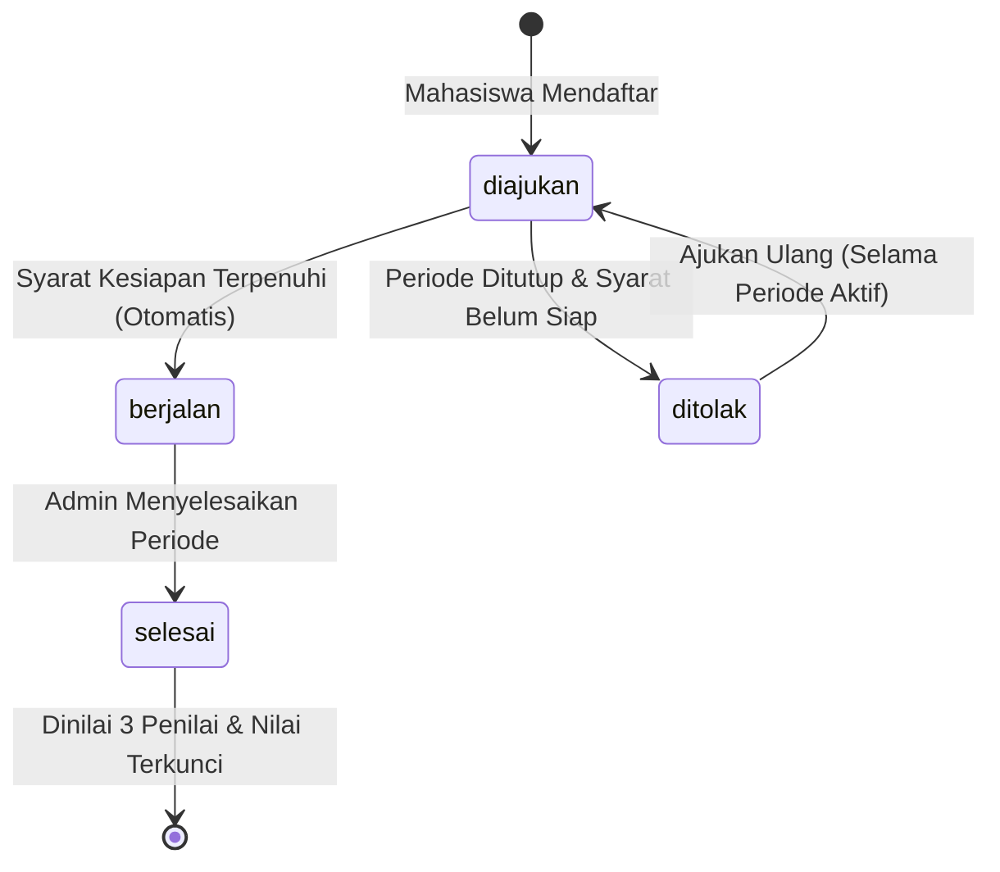

# SPLK API Contract & Frontend Integration Guide
**Sistem Pembelajaran Luar Kampus (Magang, Asistensi Mengajar, KKN) — UPA TIK Undiksha**
*Versi Dokumen: 1.0 | Status: Siap Integrasi*

Dokumen ini disusun khusus sebagai panduan integrasi bagi tim pengembang Frontend (Web/Mobile) dengan Backend SPLK (Go / Gin / PostgreSQL).

---

## Daftar Isi
1. [Spesifikasi Global & Standar API](#1-spesifikasi-global--standar-api)
2. [Autentikasi & Penanganan Token](#2-autentikasi--penanganan-token)
3. [Alur Bisnis & State Machine Program](#3-alur-bisnis--state-machine-program)
4. [Katalog Kontrak Endpoint per Peran](#4-katalog-kontrak-endpoint-per-peran)
   - [A. Otentikasi & Profil](#a-otentikasi--profil)
   - [B. Modul Mahasiswa](#b-modul-mahasiswa)
   - [C. Modul Dosen](#c-modul-dosen)
   - [D. Modul Pembimbing Lapangan (Mitra/Guru/Kades)](#d-modul-pembimbing-lapangan-mitragurukades)
   - [E. Modul Admin & Pegawai (PIC/Kejur)](#e-modul-admin--pegawai-pickejur)
5. [Pengunggahan Dokumen (Multipart/Form-Data)](#5-pengunggahan-dokumen-multipartform-data)
6. [Kamus Kode Error (Error Codes Catalog)](#6-kamus-kode-error-error-codes-catalog)
7. [Contoh Implementasi Frontend (TypeScript & Axios Interceptor)](#7-contoh-implementasi-frontend-typescript--axios-interceptor)
8. [Swagger & OpenAPI Specs](#8-swagger--openapi-specs)

---

## 1. Spesifikasi Global & Standar API

### Base URL
- **Lokal / Development:** `http://localhost:8080/api/v1`
- *(Catatan: Backend juga mendukung alias tanpa prefix `/api/v1`, contoh: `http://localhost:8080/auth/login`)*

### Header HTTP Standar
```http
Content-Type: application/json
Accept: application/json
Authorization: Bearer <ACCESS_TOKEN>
```

### Format Respon Sukses

#### A. Single Data
```json
{
  "status": "success",
  "data": {
    "id": 1,
    "nama": "Pendidikan Teknik Informatika"
  }
}
```

#### B. List Data dengan Paginasi
```json
{
  "status": "success",
  "data": [
    { "id": 1, "nama": "Fakultas Teknik dan Kejuruan" }
  ],
  "meta": {
    "total": 45,
    "limit": 20,
    "offset": 0
  }
}
```

### Format Respon Error Terstandar
Jika terjadi kegagalan validasi atau logika bisnis, backend selalu mengembalikan status HTTP `4xx`/`5xx` dengan format JSON:
```json
{
  "error": {
    "code": "PRODI_TIDAK_DITEMUKAN",
    "message": "program studi tidak ditemukan"
  }
}
```

### Kode Status HTTP Utama
| Status HTTP | Makna | Keterangan |
|---|---|---|
| `200 OK` | Sukses | Request berhasil diproses. |
| `201 Created` | Data Dibuat | Entitas berhasil disimpan (pendaftaran, unggah dokumen, dll). |
| `400 Bad Request` | Payload Tidak Valid | Format JSON salah atau request body melanggar tipe data. |
| `401 Unauthorized` | Autentikasi Gagal | Token tidak disertakan, format salah, atau sudah kadaluarsa. |
| `403 Forbidden` | Akses Ditolak | User tidak memiliki izin/role untuk mengakses data tersebut. |
| `404 Not Found` | Tidak Ditemukan | Data tidak ada atau relasi kepemilikan data bukan milik user pemanggil. |
| `409 Conflict` | Konflik Data | Contoh: Mahasiswa mendaftar dua kali pada periode yang sama. |
| `422 Unprocessable` | Pelanggaran Aturan Bisnis | Parameter valid secara format namun melanggar *Business Rules*. |
| `429 Too Many Req` | Rate Limit Terlampaui | Terlalu banyak percobaan login gagal (>5 req/menit). |
| `500 Server Error` | Kesalahan Internal | Terjadi kendala tak terduga pada server/database. |

---

## 2. Autentikasi & Penanganan Token

Sistem menggunakan **JWT (JSON Web Token)** dengan skema Bearer Token:
- **Access Token:** Masa berlaku 24 jam (dev) / 15 menit (prod). Disimpan di memory atau local state frontend.
- **Refresh Token:** String acak kriptografis (masa aktif 7 hari). Disimpan aman untuk memperpanjang sesi login.

### Alur Sesi & Interceptor
1. User login via `POST /auth/login`. Simpan `token`, `refresh_token`, dan `user.roles`.
2. Sertakan header `Authorization: Bearer <token>` pada setiap request terautentikasi.
3. Jika backend merespon `401 Unauthorized`:
   - Kirim request `POST /auth/refresh` dengan body `{ "refresh_token": "..." }`.
   - Jika refresh token masih valid: simpan token baru dan ulangi request yang gagal.
   - Jika refresh gagal: arahkan user kembali ke halaman Login.

### Daftar Peran (Roles)
- `admin`: Pengelola master sistem, seluruh periode, penempatan AM/KKN, dan instrumen penilaian.
- `pegawai`: Koordinator Kejuruan/PIC program; menetapkan dosen pembimbing magang.
- `mahasiswa`: Peserta program; mendaftar, memilih lokasi magang mandiri, mengunggah berkas, mengisi jurnal harian, dan melihat nilai.
- `dosen`: Pembimbing akademik dan/atau Penguji ujian akhir; mengisi logbook bimbingan dan menilai.
- `pembimbing_lapangan`: Mentor industri (Magang), Guru Pamong (AM), atau Kepala Desa (KKN); menilai kinerja mahasiswa di lapangan.

---

## 3. Alur Bisnis & State Machine Program

### Siklus Status Pendaftaran (`peserta_program.status`)



### Tabel Matriks Syarat Transisi Otomatis ke `berjalan`
Backend menjalankan mesin evaluasi kesiapan (*readiness engine*) otomatis setiap kali ada perubahan data:

| Jenis Program | Syarat Penempatan & Mitra | Syarat Dosen | Syarat Dokumen |
|---|---|---|---|
| **Magang** | Tempat Magang Aktif & Mentor Industri (`mentor`) | Dosen Pembimbing (`dosen`) | Dokumen `mou` & `proposal` (status: `aktif`) |
| **Asistensi Mengajar (AM)** | Sekolah Aktif & Guru Pamong (`guru_pamong`) | Dosen Pembimbing & Dosen Penguji (Dua dosen berbeda) | Dokumen `proker` milik peserta |
| **KKN** | Kelompok KKN terbentuk (min 1 mhs & 1 ketua) + Desa KKN & Kepala Desa | Dosen Pembimbing Kelompok | Dokumen `proker` milik kelompok KKN |

---

## 4. Katalog Kontrak Endpoint per Peran

### A. Otentikasi & Profil

#### 1. Login
- **Endpoint:** `POST /auth/login`
- **Akses:** Publik (Rate limit: 5 percobaan/menit)
- **Request Body:**
```json
{
  "username": "mhs_budi",
  "password": "MhsPassword123!"
}
```
- **Response 200 OK:**
```json
{
  "status": "success",
  "data": {
    "token": "eyJhbGciOiJIUzI1NiIsInR5cCI6IkpXVCJ9...",
    "refresh_token": "a4f8e912c...",
    "user": {
      "id": 10,
      "username": "mhs_budi",
      "email": "budi@undiksha.ac.id",
      "roles": ["mahasiswa"]
    }
  }
}
```

#### 2. Refresh Token
- **Endpoint:** `POST /auth/refresh`
- **Request Body:**
```json
{
  "refresh_token": "a4f8e912c..."
}
```
- **Response 200 OK:**
```json
{
  "status": "success",
  "data": {
    "token": "eyJhbGciOiJIUzI1NiIsIn...",
    "refresh_token": "b7e12f09..."
  }
}
```

#### 3. Profil Pengguna Saat Ini
- **Endpoint:** `GET /auth/me`
- **Headers:** `Authorization: Bearer <TOKEN>`
- **Response 200 OK:**
```json
{
  "status": "success",
  "data": {
    "id": 10,
    "username": "mhs_budi",
    "email": "budi@undiksha.ac.id",
    "roles": ["mahasiswa"],
    "profiles": {
      "mahasiswa": {
        "id": 5,
        "nim": "2215101001",
        "nama": "Budi Santoso",
        "angkatan": 2022,
        "prodi": {
          "id": 1,
          "nama": "Pendidikan Teknik Informatika",
          "kode": "PTI"
        }
      }
    }
  }
}
```

---

### B. Modul Mahasiswa

#### 1. Melihat Periode Program Aktif
- **Endpoint:** `GET /periode`
- **Headers:** `Authorization: Bearer <TOKEN_MHS>`
- **Query Params:** `jenis_program=magang` *(opsional)*, `status=aktif` *(opsional)*
- **Response 200 OK:**
```json
{
  "status": "success",
  "data": [
    {
      "id": 1,
      "nama": "Magang MBKM Semester Ganjil 2026/2027",
      "jenis_program": "magang",
      "tahun_semester": "2026/2027-1",
      "tanggal_mulai": "2026-08-01",
      "tanggal_selesai": "2026-12-31",
      "status": "aktif"
    }
  ]
}
```

#### 2. Mendaftar Program
- **Endpoint:** `POST /pendaftaran`
- **Headers:** `Authorization: Bearer <TOKEN_MHS>`
- **Request Body:**
```json
{
  "id_periode": 1
}
```
- **Response 201 Created:**
```json
{
  "status": "success",
  "data": {
    "id": 12,
    "id_periode": 1,
    "jenis_program": "magang",
    "status": "diajukan"
  }
}
```

#### 3. Detail Pendaftaran & Cek Kesiapan
- **Endpoint:** `GET /pendaftaran/:id`
- **Headers:** `Authorization: Bearer <TOKEN_MHS>`
- **Response 200 OK:**
```json
{
  "status": "success",
  "data": {
    "id": 12,
    "status": "diajukan",
    "jenis_program": "magang",
    "tempat_program": {
      "id": 1,
      "nama": "PT Teknologi Nusantara"
    },
    "kesiapan": {
      "siap": false,
      "kekurangan": [
        "dosen pembimbing belum ditetapkan",
        "dokumen proposal belum diunggah"
      ]
    }
  }
}
```

#### 4. Penempatan Magang Mandiri (Khusus Magang)
- **Endpoint:** `PUT /pendaftaran/:id/penempatan-magang`
- **Headers:** `Authorization: Bearer <TOKEN_MHS>`
- **Request Body:**
```json
{
  "id_tempat_program": 1,
  "id_pembimbing_lapangan": 2
}
```

#### 5. Pengisian Jurnal Harian (Status: `berjalan`)
- **Endpoint:** `POST /pendaftaran/:id/jurnal`
- **Headers:** `Authorization: Bearer <TOKEN_MHS>`
- **Request Body:**
```json
{
  "tanggal": "2026-10-16",
  "kegiatan": "Implementasi endpoint REST API dengan Gin Framework",
  "kendala": "Penyesuaian relasi database",
  "status": "disubmit"
}
```

#### 6. Melihat Nilai Akhir (Status: `selesai`)
- **Endpoint:** `GET /pendaftaran/:id/nilai`
- **Headers:** `Authorization: Bearer <TOKEN_MHS>`
- **Response 200 OK:**
```json
{
  "status": "success",
  "data": {
    "id_pendaftaran": 12,
    "nilai_akhir": 86.5,
    "grade_huruf": "A",
    "items": [
      {
        "nama_aspek": "Bimbingan dan Sikap Kerja",
        "role_penilai": "dosen_pembimbing",
        "bobot": 35,
        "nilai": 85
      },
      {
        "nama_aspek": "Kinerja Praktik Lapangan",
        "role_penilai": "pembimbing_lapangan",
        "bobot": 35,
        "nilai": 88
      },
      {
        "nama_aspek": "Ujian Akhir Laporan",
        "role_penilai": "dosen_penguji",
        "bobot": 30,
        "nilai": 87
      }
    ]
  }
}
```

---

### C. Modul Dosen

#### 1. Mengisi Logbook Bimbingan Mahasiswa
- **Endpoint:** `POST /pendaftaran/:id/logbook`
- **Headers:** `Authorization: Bearer <TOKEN_DOSEN>`
- **Request Body:**
```json
{
  "tanggal": "2026-10-16",
  "topik_bimbingan": "Evaluasi Progres Bab 3 dan Pengujian API",
  "catatan_perkembangan": "Mahasiswa telah memahami alur pembuatan endpoint",
  "kendala_mahasiswa": "Perlu optimalisasi query SQL",
  "solusi_rekomendasi": "Gunakan indeks pada kolom filter"
}
```

#### 2. Mengambil Form Penilaian
- **Endpoint:** `GET /pendaftaran/:id/form-penilaian`
- **Headers:** `Authorization: Bearer <TOKEN_DOSEN>`
- **Response 200 OK:**
```json
{
  "status": "success",
  "data": {
    "id_pendaftaran": 12,
    "role_penilai": "dosen_pembimbing",
    "instrumen": [
      {
        "id_instrumen": 1,
        "nama_aspek": "Bimbingan dan Sikap Kerja",
        "bobot": 35,
        "nilai_saat_ini": null
      }
    ]
  }
}
```

#### 3. Submit Nilai Mahasiswa
- **Endpoint:** `POST /pendaftaran/:id/penilaian`
- **Headers:** `Authorization: Bearer <TOKEN_DOSEN>`
- **Request Body:**
```json
{
  "items": [
    {
      "id_instrumen": 1,
      "nilai": 85.5,
      "catatan": "Keaktifan bimbingan sangat baik"
    }
  ]
}
```

---

### D. Modul Pembimbing Lapangan (Mitra/Guru/Kades)
Pembimbing lapangan menggunakan alur penilaian yang sama persis dengan dosen:
1. `GET /pendaftaran/:id/form-penilaian` -> Mengambil aspek penilaian lapangan (bobot mitra).
2. `POST /pendaftaran/:id/penilaian` -> Mengirim skor (0–100).

---

### E. Modul Admin & Pegawai (PIC/Kejur)

#### 1. Penetapan Dosen Pembimbing Magang (Oleh Pegawai/Kejur atau Admin)
- **Endpoint:** `PUT /pendaftaran/:id/dosen-pembimbing`
- **Request Body:**
```json
{
  "id_dosen": 3
}
```

#### 2. Penempatan Asistensi Mengajar (Oleh Admin)
- **Endpoint:** `PUT /admin/pendaftaran/:id/penempatan`
- **Request Body:**
```json
{
  "id_tempat_program": 4,
  "id_pembimbing_lapangan": 7
}
```

#### 3. Penetapan Dosen Penguji (Oleh Admin)
- **Endpoint:** `PUT /admin/pendaftaran/:id/dosen-penguji`
- **Request Body:**
```json
{
  "id_dosen": 5
}
```
*(Catatan: Dosen penguji tidak boleh sama dengan dosen pembimbing, akan ditolak HTTP 422).*

#### 4. Manajemen Kelompok KKN (Oleh Admin)
- `POST /admin/kkn/kelompok`: Buat kelompok baru + tetapkan ketua kelompok.
- `POST /admin/kkn/kelompok/:id/anggota`: Tambah anggota mahasiswa (`id_peserta_program`).
- `PUT /admin/kkn/kelompok/:id/dosen-pembimbing`: Tetapkan dosen pembimbing kelompok KKN.
- `PUT /admin/kkn/kelompok/:id/pembimbing-lapangan`: Tetapkan kepala desa pembimbing lapangan.

---

## 5. Pengunggahan Dokumen (Multipart/Form-Data)

### Aturan File
- **Format yang diizinkan:** PDF (`.pdf`), Word (`.docx`), Gambar (`.png`, `.jpg`, `.jpeg`).
- **Ukuran Maksimal:** 10 MB per file.

### 1. Unggah Dokumen Peserta (MoU, Proposal Magang, Proker AM)
- **Endpoint:** `POST /pendaftaran/:id/dokumen`
- **Headers:**
  - `Authorization: Bearer <TOKEN_MAHASISWA>`
  - `Content-Type: multipart/form-data`
- **Form Data Fields:**
  - `jenis_dokumen`: `mou` | `proposal` | `proker`
  - `file`: `(Binary file)`

### 2. Unggah Dokumen Kelompok KKN (Proker Kelompok)
- **Endpoint:** `POST /kkn/kelompok/:id/dokumen`
- **Headers:** `Authorization: Bearer <TOKEN_MAHASISWA_ANGGOTA_KKN>`
- **Form Data Fields:**
  - `jenis_dokumen`: `proker`
  - `file`: `(Binary file)`

### 3. Mengunduh Dokumen
- **Endpoint:** `GET /dokumen/:id/download`
- **Headers:** `Authorization: Bearer <TOKEN>`
- *(Respons langsung berupa binary stream file beserta Content-Disposition nama file asli).*

---

## 6. Kamus Kode Error (Error Codes Catalog)

Frontend dapat memanfaatkan nilai `error.code` untuk memetakan pesan toast/alert atau form invalidation secara tepat:

| Kode Error (`error.code`) | HTTP Status | Penyebab & Tindakan Frontend |
|---|---|---|
| `UNAUTHORIZED` | 401 | Sesi habis / token tidak valid. Arahkan ke Login. |
| `FORBIDDEN` | 403 | Pengguna tidak berhak mengakses entitas ini. |
| `TERLALU_BANYAK_PERMINTAAN` | 429 | Rate limit login aktif (tunggu 1 menit). |
| `PRODI_TIDAK_DITEMUKAN` | 422 | ID prodi yang dikirim tidak ada di database. |
| `PERIODE_TIDAK_AKTIF` | 422 | Pendaftaran ditolak karena periode belum dibuka / sudah lewat. |
| `PENDAFTARAN_GANDA` | 409 | Mahasiswa sudah terdaftar pada periode tersebut. |
| `STATUS_TIDAK_VALID` | 422 | Aksi tidak diizinkan pada status pendaftaran saat ini. |
| `DOSEN_PEMBIMBING_SAMA_DENGAN_PENGUJI` | 422 | Pelanggaran aturan: Dosen penguji tidak boleh merangkap pembimbing. |
| `FILE_TERLALU_BESAR` | 400 | Ukuran file melebihi batas 10 MB. |
| `TIPE_FILE_TIDAK_DIIZINKAN` | 400 | Ekstensi file bukan PDF/DOCX/PNG/JPG. |
| `NILAI_SUDAH_TERKUNCI` | 422 | Nilai akhir sudah terhitung, penilaian tidak dapat diubah lagi. |

---

## 7. Contoh Implementasi Frontend (TypeScript & Axios Interceptor)

Berikut adalah contoh boilerplate siap pakai untuk tim Frontend (React, Vue, Next.js, atau React Native):

### TypeScript Definitions (`types/api.ts`)
```typescript
export type Role = 'admin' | 'pegawai' | 'mahasiswa' | 'dosen' | 'pembimbing_lapangan';
export type JenisProgram = 'magang' | 'asistensi_mengajar' | 'kkn';
export type StatusPendaftaran = 'diajukan' | 'berjalan' | 'selesai' | 'ditolak';

export interface ApiResponse<T> {
  status: 'success';
  data: T;
  meta?: {
    total: number;
    limit: number;
    offset: number;
  };
}

export interface ApiError {
  error: {
    code: string;
    message: string;
  };
}

export interface UserSummary {
  id: number;
  username: string;
  email: string;
  roles: Role[];
}

export interface Pendaftaran {
  id: number;
  id_periode: number;
  jenis_program: JenisProgram;
  status: StatusPendaftaran;
  kesiapan?: {
    siap: boolean;
    kekurangan: string[];
  };
}
```

### Axios Client dengan Auto-Refresh Interceptor (`services/apiClient.ts`)
```typescript
import axios from 'axios';

export const apiClient = axios.create({
  baseURL: process.env.NEXT_PUBLIC_API_URL || 'http://localhost:8080/api/v1',
  headers: {
    'Content-Type': 'application/json',
  },
});

// 1. Request Interceptor: Tambahkan Bearer Token otomatis
apiClient.interceptors.request.use((config) => {
  const token = localStorage.getItem('access_token');
  if (token && config.headers) {
    config.headers.Authorization = `Bearer ${token}`;
  }
  return config;
});

// 2. Response Interceptor: Tangani 401 & Refresh Token otomatis
apiClient.interceptors.response.use(
  (response) => response,
  async (error) => {
    const originalRequest = error.config;
    if (error.response?.status === 401 && !originalRequest._retry) {
      originalRequest._retry = true;
      const refreshToken = localStorage.getItem('refresh_token');

      if (!refreshToken) {
        localStorage.clear();
        window.location.href = '/login';
        return Promise.reject(error);
      }

      try {
        const res = await axios.post('http://localhost:8080/api/v1/auth/refresh', {
          refresh_token: refreshToken,
        });

        const newAccessToken = res.data.data.token;
        const newRefreshToken = res.data.data.refresh_token;

        localStorage.setItem('access_token', newAccessToken);
        localStorage.setItem('refresh_token', newRefreshToken);

        originalRequest.headers.Authorization = `Bearer ${newAccessToken}`;
        return apiClient(originalRequest);
      } catch (refreshErr) {
        localStorage.clear();
        window.location.href = '/login';
        return Promise.reject(refreshErr);
      }
    }
    return Promise.reject(error);
  }
);
```

---

## 8. Swagger & OpenAPI Specs

Untuk melihat skema interaktif, form uji coba real-time, atau mengunduh spesifikasi mentah untuk generator kode:
- **Swagger UI Interaktif:** `http://localhost:8080/swagger/index.html` *(ketika `APP_ENV=development`)*
- **Spesifikasi JSON OpenAPI:** `docs/swagger.json`
- **Spesifikasi YAML OpenAPI:** `docs/swagger.yaml`

*(File `swagger.json` dapat langsung diimport ke **Postman**, **Insomnia**, atau generator TypeScript SDK seperti **Orval** / **openapi-typescript-codegen**).*
