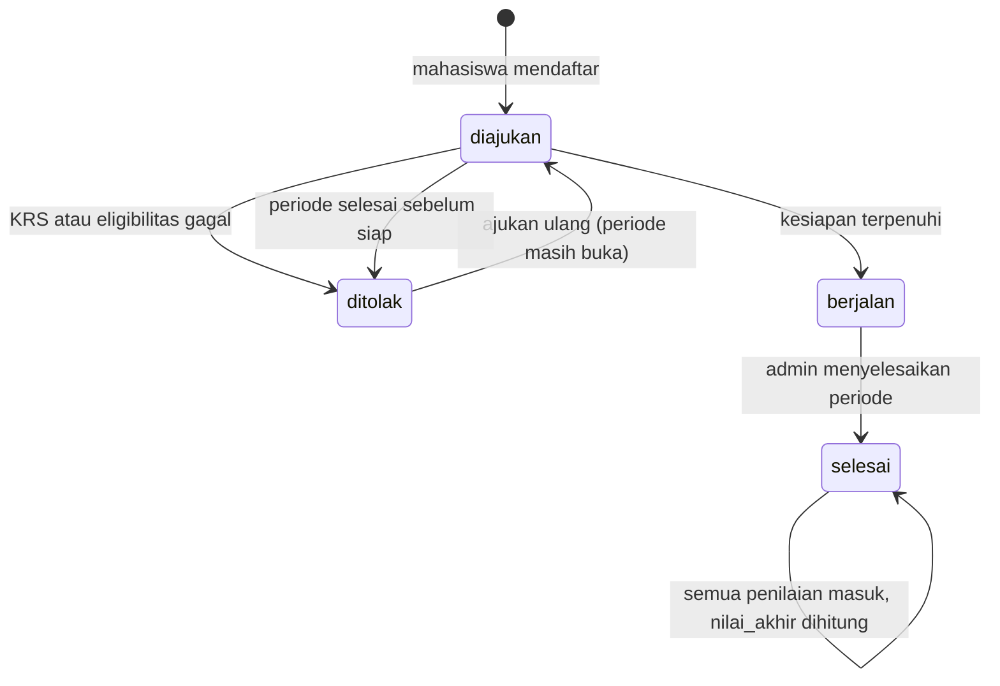

# PRD: Backend Sistem Pembelajaran Luar Kampus (SPLK)

Versi 1.0 | UPA TIK Undiksha | Status: draft, menunggu konfirmasi mentor pada bagian "Pertanyaan Terbuka"

## 1. Ringkasan

SPLK menggabungkan tiga program pembelajaran luar kampus dalam satu platform: **Magang**, **Asistensi Mengajar (AM)**, dan **KKN**. Dokumen ini hanya mencakup **backend (REST API)**. Frontend dikerjakan terpisah.

Sumber kebenaran proyek ini ada dua:

1. Diagram BPMN "Sistem Pembelajaran Luar Kampus" dari mentor.
2. Skema database v2 (`sistem_pembelajaran_luar_kampus_migration.sql`).

Ketiga program memiliki kerangka yang sama: daftar, validasi, penempatan, pelaksanaan (jurnal dan logbook), penilaian, nilai akhir. Perbedaannya hanya ada di tahap penempatan. Karena itu, sistem dibangun dengan satu inti bersama (`peserta_program`) dan logika khusus per program.

## 2. Tujuan dan Non-Tujuan

**Tujuan**

- Mengotomasi seluruh alur pada diagram BPMN lewat REST API.
- Menyediakan kontrol akses berbasis role dan relasi (siapa membimbing siapa).
- Menyimpan jejak pelaksanaan (jurnal, logbook, dokumen) dan menghitung nilai akhir.
- Mudah diganti pada bagian yang aturannya belum diketahui (KRS, eligibilitas, bobot nilai).

**Non-tujuan (di luar lingkup)**

- Frontend atau UI.
- Integrasi nyata ke sistem akademik (KRS dan eligibilitas di-stub).
- SSO kampus, notifikasi email atau WhatsApp, CI/CD, deployment produksi.
- Containerisasi PostgreSQL (database berjalan di host, hanya backend Go yang di-Docker).

## 3. Aktor dan Role

| Lane di diagram | Role di sistem | Tabel profil | Catatan |
|---|---|---|---|
| Sistem (Core Platform) | tidak ada | tidak ada | Logika otomatis di service layer |
| Mahasiswa | `mahasiswa` | `mahasiswa` | |
| Admin | `admin` | `admin` | |
| Kejur/PIC | `pegawai` | `pegawai` | Tanpa batasan jurusan (lihat bagian 9) |
| Dosen Pembimbing | `dosen` | `dosen` | Ditentukan relasi `peserta_program.id_dosen_pembimbing` |
| Dosen Penguji | `dosen` | `dosen` | Ditentukan relasi `peserta_program.id_dosen_penguji` |
| Mitra Lapangan | `pembimbing_lapangan` | `pembimbing_lapangan` | Mentor (magang), guru pamong (AM), kepala desa (KKN). Wajib punya akun untuk menilai |

Seorang dosen yang sama bisa menjadi pembimbing pada satu peserta dan penguji pada peserta lain. Karena itu, "pembimbing" dan "penguji" **bukan role**, melainkan relasi pada setiap pendaftaran.

## 4. Alur Bisnis

### 4.1 Urutan umum (dari diagram)

1. Admin membuat periode program, lalu mengaktifkannya.
2. Mahasiswa mendaftar pada periode (jenis program ikut jenis periode).
3. Sistem memvalidasi KRS dan eligibilitas. Jika gagal, pendaftaran berstatus `ditolak`.
4. Penempatan, bercabang per program:
   - **Magang**: mahasiswa memilih tempat magang dan mentor, Kejur/PIC menetapkan dosen pembimbing, mahasiswa mengunggah MoU dan proposal.
   - **AM**: admin memetakan sekolah, menetapkan dosen pembimbing dan guru pamong, mahasiswa menyusun proker (unggah dokumen).
   - **KKN**: admin memetakan desa dan kelompok, menetapkan dosen pembimbing per kelompok, mahasiswa menyusun proker.
5. Cabang bertemu kembali. Saat kesiapan terpenuhi, pendaftaran berstatus `berjalan`.
6. Selama periode berjalan: mahasiswa mengisi jurnal harian, dosen pembimbing mengisi logbook bimbingan.
7. Admin menyelesaikan periode. Pendaftaran `berjalan` menjadi `selesai`.
8. Dosen pembimbing, dosen penguji, dan pembimbing lapangan memberi nilai (urutan bebas, paralel).
9. Sistem menghitung nilai akhir setelah semua penilaian lengkap.

### 4.2 Status `peserta_program.status`

Database v2 hanya mengenal empat status: `diajukan`, `ditolak`, `berjalan`, `selesai`. Dua tahap pada diagram tidak punya status sendiri dan **diturunkan**:

- "Menunggu penempatan" adalah `diajukan` dengan kesiapan belum terpenuhi.
- "Sudah dinilai" adalah `selesai` dengan `nilai_akhir IS NOT NULL`.

### 4.3 Kesiapan menjadi `berjalan` (dicek otomatis setiap ada perubahan relevan)

| Program | Syarat |
|---|---|
| Magang | `id_tempat_program`, `id_pembimbing_lapangan`, `id_dosen_pembimbing` terisi; dokumen `mou` dan `proposal` ada; periode berstatus `aktif` |
| AM | `id_tempat_program`, `id_pembimbing_lapangan` (guru pamong), `id_dosen_pembimbing` terisi; dokumen `proker` ada; periode `aktif` |
| KKN | `id_kelompok_kkn`, `id_tempat_program`, `id_dosen_pembimbing` terisi; dokumen `proker` (milik kelompok atau peserta) ada; periode `aktif` |

## 5. Kebutuhan Fungsional

Semua endpoint berprefiks `/api/v1`. Kolom Aktor menunjukkan siapa yang boleh memanggil. `admin` selalu boleh memanggil endpoint milik `pegawai`.

### 5.1 Autentikasi

| Endpoint | Aktor | Fungsi |
|---|---|---|
| `POST /auth/login` | publik | Login username dan password, mengembalikan access token dan refresh token |
| `POST /auth/refresh` | publik | Tukar refresh token (rotasi: token lama dihapus) |
| `POST /auth/logout` | login | Hapus refresh token |
| `GET /auth/me` | login | Profil singkat, role, dan ID profil |
| `PUT /auth/password` | login | Ganti password sendiri |

### 5.2 Manajemen akun dan master data (admin)

| Endpoint | Fungsi |
|---|---|
| `POST/GET/PUT /admin/mahasiswa`, `/admin/dosen`, `/admin/pegawai`, `/admin/pembimbing-lapangan`, `/admin/admins` | Buat akun beserta profil dan role dalam satu transaksi, daftar, ubah |
| `GET /admin/users`, `GET /admin/users/:id` | Daftar dan detail akun (filter role, pencarian, pagination) |
| `PATCH /admin/users/:id/status` | Aktif atau nonaktifkan akun (tidak ada hapus akun) |
| `POST /admin/users/:id/reset-password` | Reset password |
| `/admin/fakultas`, `/admin/jurusan`, `/admin/program-studi` | CRUD hierarki akademik. `GET` terbuka untuk semua user login |
| `/admin/tempat-program` | CRUD tempat. `DELETE` berarti `is_aktif=false`. `GET /tempat-program` terbuka untuk user login (filter jenis dan aktif) |
| `GET /tempat-program/:id/pembimbing-lapangan` | Daftar pembimbing lapangan di tempat itu (dipakai mahasiswa magang memilih mentor) |
| `/admin/instrumen-penilaian` | CRUD instrumen dan bobot, serta ringkasan total bobot per program dan role |

### 5.3 Periode

| Endpoint | Aktor | Fungsi |
|---|---|---|
| `POST /admin/periode`, `PUT /admin/periode/:id` | admin | Buat dan ubah (hanya saat `draft`) |
| `POST /admin/periode/:id/aktifkan` | admin | `draft` ke `aktif` |
| `POST /admin/periode/:id/selesaikan` | admin | `aktif` ke `selesai`. Satu transaksi: peserta `berjalan` menjadi `selesai`, peserta `diajukan` menjadi `ditolak` dengan alasan otomatis |
| `GET /periode`, `GET /periode/:id` | login | Mahasiswa hanya melihat periode `aktif` |

### 5.4 Pendaftaran dan penempatan

| Endpoint | Aktor | Fungsi |
|---|---|---|
| `POST /pendaftaran` | mahasiswa | Daftar `{id_periode}`. Menjalankan validasi KRS dan eligibilitas |
| `POST /pendaftaran/:id/ajukan-ulang` | mahasiswa | Ajukan ulang pendaftaran `ditolak` selama periode masih buka |
| `GET /pendaftaran`, `GET /pendaftaran/:id` | semua (dibatasi scope) | Daftar dan detail, dibatasi sesuai aturan akses BR-14 |
| `PUT /pendaftaran/:id/penempatan-magang` | mahasiswa | Pilih tempat dan mentor `{id_tempat_program, id_pembimbing_lapangan}` (khusus magang) |
| `PUT /pendaftaran/:id/dosen-pembimbing` | pegawai (magang), admin (semua) | Tetapkan dosen pembimbing `{id_dosen}` |
| `PUT /admin/pendaftaran/:id/penempatan` | admin | Pemetaan sekolah dan guru pamong (AM) `{id_tempat_program, id_pembimbing_lapangan}` |
| `PUT /admin/pendaftaran/:id/dosen-penguji` | admin | Tetapkan dosen penguji |
| `POST /admin/kkn/kelompok`, `GET /admin/kkn/kelompok`, `GET /admin/kkn/kelompok/:id` | admin | Buat dan lihat kelompok KKN |
| `POST /admin/kkn/kelompok/:id/anggota`, `DELETE /admin/kkn/kelompok/:id/anggota/:pid` | admin | Kelola anggota dan ketua |
| `PUT /admin/kkn/kelompok/:id/dosen-pembimbing` | admin | Tetapkan dosen pembimbing, disinkronkan ke semua anggota dalam satu transaksi |
| `PUT /admin/kkn/kelompok/:id/pembimbing-lapangan` | admin | Tetapkan kepala desa, disinkronkan ke semua anggota |

### 5.5 Dokumen (penyimpanan lokal)

| Endpoint | Aktor | Fungsi |
|---|---|---|
| `POST /pendaftaran/:id/dokumen` | mahasiswa pemilik | Unggah (multipart: `jenis_dokumen`, `file`) |
| `POST /kkn/kelompok/:id/dokumen` | anggota kelompok | Unggah dokumen milik kelompok (proker) |
| `GET /pendaftaran/:id/dokumen`, `GET /kkn/kelompok/:id/dokumen` | sesuai akses | Daftar metadata |
| `GET /dokumen/:id/download` | sesuai akses | Unduh file (terautentikasi, bukan folder publik) |
| `DELETE /dokumen/:id` | pengunggah | Hapus selama status pendaftaran `diajukan` |

### 5.6 Pelaksanaan

| Endpoint | Aktor | Fungsi |
|---|---|---|
| `POST /pendaftaran/:id/jurnal`, `GET /pendaftaran/:id/jurnal`, `PUT /pendaftaran/:id/jurnal/:jid` | mahasiswa (tulis), pihak terkait (baca) | Jurnal harian. Status `draft` atau `disubmit`. Edit hanya saat `draft` |
| `POST /pendaftaran/:id/logbook`, `GET /pendaftaran/:id/logbook`, `PUT /pendaftaran/:id/logbook/:lid` | dosen pembimbing (tulis), pihak terkait (baca) | Logbook bimbingan |

### 5.7 Penilaian

| Endpoint | Aktor | Fungsi |
|---|---|---|
| `GET /pendaftaran/:id/form-penilaian` | penilai sah | Daftar instrumen yang harus diisi oleh pemanggil |
| `POST /pendaftaran/:id/penilaian` | penilai sah | Kirim `{items:[{id_instrumen, nilai, catatan}]}` (upsert sebelum nilai akhir terhitung) |
| `GET /pendaftaran/:id/nilai` | sesuai akses | Rincian nilai per instrumen dan nilai akhir |
| `POST /admin/pendaftaran/:id/hitung-nilai` | admin | Hitung ulang nilai akhir secara manual |

### 5.8 Opsional (setelah MVP)

Review jurnal, verifikasi dokumen, pengumuman, dan surat perjalanan dinas. Tabelnya sudah ada di v2 tetapi tidak muncul pada diagram, jadi dikerjakan paling akhir (Tahap 14).

## 6. Aturan Bisnis

| ID | Aturan |
|---|---|
| BR-01 | Pendaftaran hanya jika `periode.status = 'aktif'` dan tanggal hari ini (zona Asia/Makassar) berada dalam `tanggal_buka_daftar` sampai `tanggal_tutup_daftar` (bila keduanya terisi) |
| BR-02 | `peserta_program.jenis_program` selalu sama dengan `periode.jenis_program` |
| BR-03 | Satu mahasiswa hanya punya satu pendaftaran per (periode, jenis program) |
| BR-04 | Magang: tempat berjenis `magang` dan `is_aktif`; mentor berjenis `mentor` dan milik tempat tersebut |
| BR-05 | AM: tempat berjenis `asistensi_mengajar`; pembimbing lapangan berjenis `guru_pamong` dan milik tempat tersebut |
| BR-06 | KKN: tempat berjenis `kkn`; pembimbing lapangan berjenis `kepala_desa` milik tempat tersebut; anggota kelompok adalah peserta KKN pada periode yang sama; satu ketua per kelompok |
| BR-07 | Dosen pembimbing tidak boleh sama dengan dosen penguji pada satu pendaftaran |
| BR-08 | Jurnal dan logbook hanya boleh dibuat saat status `berjalan`, dengan tanggal dalam rentang periode dan tidak di masa depan |
| BR-09 | Satu jurnal per peserta per tanggal |
| BR-10 | Penilaian hanya saat status `selesai`, oleh penilai sah, dengan instrumen yang cocok jenis program dan role penilainya. Nilai 0 sampai 100 |
| BR-11 | Nilai akhir dihitung otomatis saat seluruh instrumen program tersebut sudah terisi. Setelah terhitung, penilai tidak bisa mengubah nilai |
| BR-12 | Transisi ke `berjalan` memakai tabel kesiapan pada bagian 4.3 |
| BR-13 | Dokumen: tipe PDF, DOCX, PNG, JPG; maksimal 5 MB (dapat diatur); dokumen `mou` dan `proposal` milik peserta, `proker` boleh milik peserta atau kelompok |
| BR-14 | Akses data: mahasiswa hanya miliknya; dosen hanya peserta yang ia bimbing atau uji; pembimbing lapangan hanya peserta yang ia dampingi; admin dan pegawai semuanya |
| BR-15 | Penilai sah: dosen pembimbing peserta (instrumen `dosen_pembimbing`), dosen penguji peserta (`dosen_penguji`), pembimbing lapangan peserta yang punya akun (`pembimbing_lapangan`) |

## 7. Kebutuhan Non-Fungsional

- **Keamanan**: password di-hash bcrypt; JWT access token pendek (15 menit) dan refresh token acak yang disimpan dalam bentuk hash; semua query berparameter; file tidak disajikan sebagai folder statis.
- **Konsistensi data**: operasi multi-tabel (buat akun, sinkron kelompok KKN, hitung nilai, selesaikan periode) berjalan dalam transaksi.
- **Kinerja**: endpoint daftar memakai pagination (default 20, maksimal 100).
- **Observabilitas**: log terstruktur (`log/slog`), request ID, endpoint `/health` yang mengecek koneksi database.
- **Dokumentasi**: Swagger untuk seluruh endpoint.
- **Pengujian**: unit test untuk aturan bisnis penting; integration test untuk alur end-to-end tiga program.
- **Zona waktu**: kolom `TIMESTAMP` di v2 tidak menyimpan zona waktu, jadi seluruh timestamp disimpan dalam UTC. Perhitungan "hari ini" memakai Asia/Makassar.

## 8. Asumsi dan Keputusan

Asumsi bertanda **[mentor]** perlu dikonfirmasi. Seluruhnya ditandai di kode dengan komentar `// ASUMSI:` agar mudah dicari.

| ID | Asumsi |
|---|---|
| A1 | Validasi KRS di-stub (`KRSValidator` selalu `true`), sesuai arahan mentor |
| A2 | Eligibilitas AM dan KKN di-stub (`EligibilityChecker` selalu `true`). **[mentor]** syarat sebenarnya belum ada |
| A3 | Login memakai akun sendiri (username dan password), tanpa SSO |
| A4 | Rumus nilai akhir sementara: `SUM(nilai x bobot) / SUM(bobot)` atas seluruh instrumen program tersebut. **[mentor]** aturan bobot belum ada |
| A5 | Konversi nilai huruf sementara: A >= 85, B >= 70, C >= 55, D >= 40, selainnya E. **[mentor]** |
| A6 | `sks_diakui` tidak dihitung (dibiarkan NULL) sampai ada aturan. **[mentor]** |
| A7 | Transisi ke `berjalan` otomatis saat kesiapan terpenuhi, tanpa tombol persetujuan |
| A8 | Pembimbing lapangan wajib punya akun agar bisa menilai |
| A9 | "Input data AM" dan "Input data KKN" pada diagram dianggap sudah tercakup oleh pendaftaran. Tidak ada tabel khusus. **[mentor]** apakah ada data tambahan |
| A10 | Kejur adalah role `pegawai` tanpa batasan jurusan. **[mentor]** |
| A11 | Mahasiswa boleh mendaftar lebih dari satu program dalam satu semester (constraint v2 mengizinkan). **[mentor]** |
| A12 | Saat periode diselesaikan, pendaftaran `diajukan` yang belum siap menjadi `ditolak` dengan alasan otomatis |
| A13 | Pendaftaran `ditolak` dapat diajukan ulang selama periode masih buka |

## 9. Batasan Database v2 dan Cara Penanganannya

Rancangan v2 dipakai sesuai keputusan, dengan **satu perubahan wajib** (nomor 1). Sisanya ditangani di kode.

| No | Batasan di v2 | Penanganan |
|---|---|---|
| 1 | `peserta_program.id_tempat_program` bersifat `NOT NULL`, padahal pada AM dan KKN penempatan baru ditentukan setelah mendaftar | **Migrasi 000002** menghapus `NOT NULL` pada kolom ini. Tanpa itu alur AM dan KKN tidak bisa diimplementasikan |
| 2 | `periode.dibuat_oleh` mengacu ke `pegawai`, padahal pembuatnya admin | Isi hanya bila pembuat punya profil pegawai, selain itu `NULL` |
| 3 | `log_aktivitas.id_user` `NOT NULL` | Login gagal dengan username tak dikenal hanya dicatat ke log aplikasi (slog) |
| 4 | `penilaian.id_penilai` mengacu ke `users` dan `NOT NULL` | Pembimbing lapangan tanpa akun tidak bisa menilai (A8) |
| 5 | `status` dan `jenis_program` bertipe VARCHAR tanpa CHECK | Validasi di service. Konstanta didefinisikan satu tempat |
| 6 | `jenis_program` peserta tidak dikunci terhadap periode dan tempat | Divalidasi di service (BR-02, BR-04 sampai BR-06) |
| 7 | Dosen pembimbing dan pembimbing lapangan KKN ada di dua tabel (`kelompok_kkn` dan `peserta_program`) | `peserta_program` adalah sumber utama. Perubahan di kelompok disinkronkan ke seluruh anggota dalam satu transaksi |
| 8 | `kelompok_kkn.proker_url` duplikat dengan tabel `dokumen` | Kolom tidak dipakai. Proker disimpan di `dokumen` |
| 9 | `dokumen.file_url` | Diisi path relatif file lokal, bukan URL |
| 10 | Total bobot per program tidak dapat dijaga database | Endpoint ringkasan bobot di admin dan pemeriksaan saat hitung nilai |
| 11 | Status `menunggu_penempatan` dan `dinilai` tidak ada | Diturunkan (bagian 4.2) |

**Perbaikan lanjutan (opsional, setelah disetujui mentor, lewat migrasi baru)**: CHECK untuk kolom `status` dan `jenis_program`, composite FK agar jenis program peserta cocok dengan periode dan tempat, CHECK `id_dosen_pembimbing <> id_dosen_penguji`, `log_aktivitas.id_user` nullable, `tokens.revoked_at`, tabel jabatan Kejur per jurusan, `nilai_dihitung_at`.

## 10. Pertanyaan Terbuka untuk Mentor

1. Apa syarat eligibilitas AM dan KKN (SKS minimal, IPK, mata kuliah prasyarat)?
2. Bagaimana bobot nilai: 100 per program secara keseluruhan, atau 100 per penilai lalu ada bobot antarpenilai? Bagaimana konversi nilai huruf dan penghitungan SKS yang diakui?
3. Apakah semua pembimbing lapangan (mentor, guru pamong, kepala desa) akan punya akun?
4. Apakah jurnal harian dan dokumen perlu diverifikasi, dan oleh siapa?
5. Apakah mahasiswa boleh mengikuti dua program berbeda dalam satu semester?
6. Siapa yang dimaksud Kejur di sistem, dan apakah wewenangnya dibatasi per jurusan?
7. Apakah ada data tambahan yang harus diinput mahasiswa pada AM dan KKN selain pendaftaran?
8. Apakah surat perjalanan dinas dan pengumuman termasuk lingkup tahap ini?

## 11. Kriteria Penerimaan MVP

MVP dianggap selesai bila tiga skenario berikut lulus sebagai integration test otomatis, dari awal sampai nilai akhir terisi:

1. **Magang**: periode, daftar, pilih tempat dan mentor, penetapan pembimbing, unggah MoU dan proposal, status `berjalan`, jurnal, logbook, periode selesai, tiga penilai menilai, `nilai_akhir` terhitung.
2. **AM**: periode, daftar, pemetaan sekolah dan guru pamong, penetapan pembimbing, unggah proker, `berjalan`, jurnal, logbook, selesai, penilaian, nilai akhir.
3. **KKN**: periode, daftar dua mahasiswa, pembentukan kelompok dan ketua, penetapan pembimbing kelompok, unggah proker kelompok, `berjalan`, jurnal, logbook, selesai, penilaian, nilai akhir.

Selain itu: `docker compose up --build` berjalan, `/health` mengembalikan `up`, dan Swagger terbuka.
